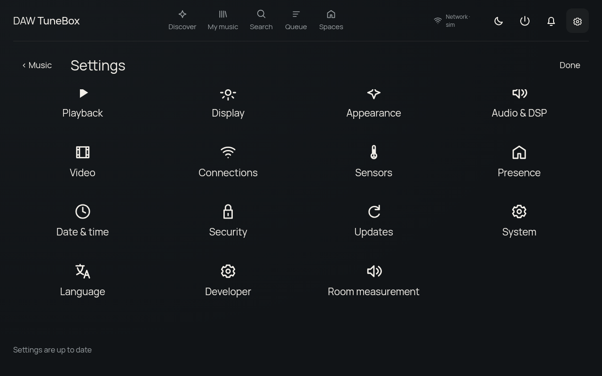
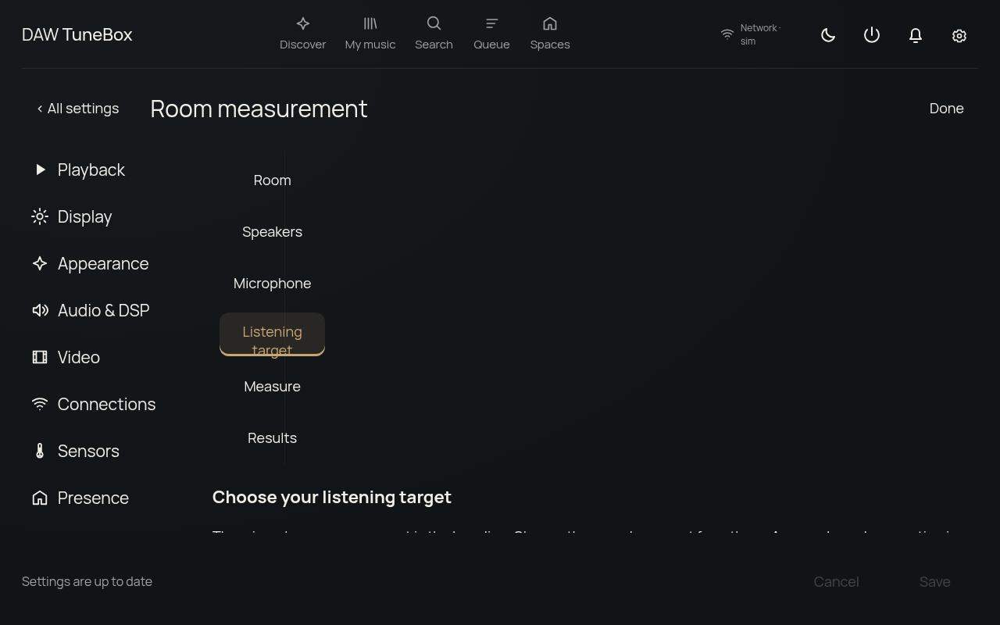
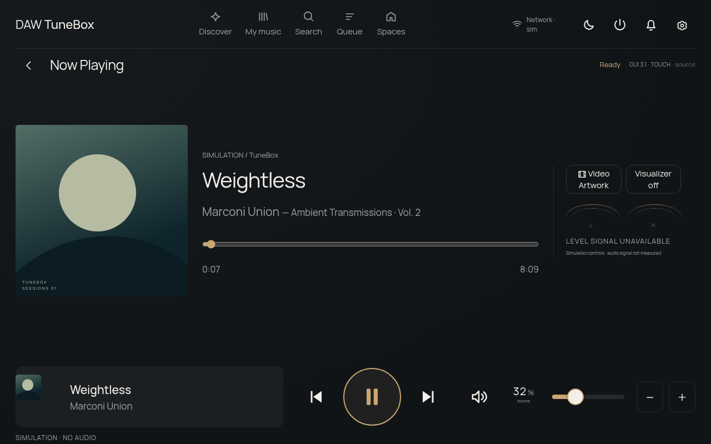
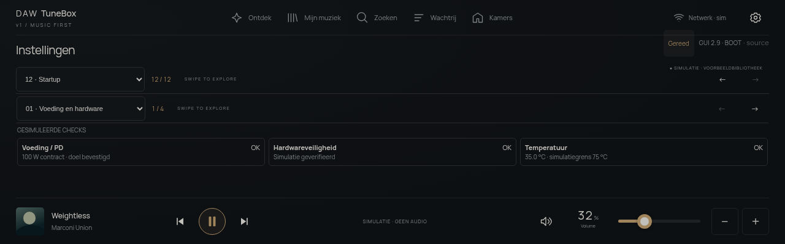

# DAW TuneBox v1 — Raspberry Pi streaming amplifier prototype

DAW TuneBox v1 aims to turn a Raspberry Pi 4 into a dedicated streaming-amplifier controller with a premium **touchscreen interface with a 16:10 wall profile and retained 1280 × 400 legacy profile**, Music Assistant playback integration and clearly modelled standby, display and safety states.

**Current release: a runnable software prototype with simulated hardware.** The interface, simulator and automated software tests are implemented. The owner has reported live Music Assistant/Squeezelite playback through a Pi 3 headphone jack. Playback reliability, kiosk performance, the Sonocotta Louder HAT and electrical protection remain under validation. No physical amplifier is enabled by this application.


*Current software screenshot using simulated playback and conceptual artwork; no Louder HAT is connected.*

## GUI 3.2.4 · STARTUP — animated WebP and reliable update display

**Current build: `GUI 3.2.4 · STARTUP` / `2026.11.12-startup.1`.** The four-second splash now uses a 1280 × 800 animated WebP by default. Its compact export is 439 KB; MP4/WebM remain reserves, with Still/Off and automatic Pi 3/reduced-motion policies retained. Replay starts afresh and the animation is available offline.

Production testing reproduced the Pi's `media error 4`: the service worker tried to cache HTTP 206 video byte ranges and turned a successful network response into an error. Video/range requests now bypass that cache. An independent kiosk unit also stays running when OTA restarts the backend; the trusted installer migrates older units with a backup.

The owner has confirmed the real PCM spectrum and a first signed OTA activation to GUI 3.2.3. The kiosk dependency and quiet-boot configuration have been repaired on that Pi. A physical cold boot and WebP playback on the Pi remain to be confirmed for this release.

**[Release notes, actual findings and hardware acceptance](docs/startup-reliability.md)**. The first post-publication check exposed an additional discovery issue: GitHub listed an older release first. The trusted updater now ranks verified signed sequence numbers rather than list position; existing devices need that helper repair once.

## GUI 3.2.3 · TOUCH — settings, wake and larger audio controls

**Touch release: `GUI 3.2.3 · TOUCH` / `2026.11.12-touch.1`.** Settings uses a 5 × 3 topic grid, a fixed Save/Cancel bar and the persistent playback footer. All settings → Now Playing and the footer provide a clear return route, with Save/Discard/Stay for unsaved edits. A single checkbox change activates Save; cancelling no longer leaves a phantom DSP edit.

The wall volume dial is 112 px; PCM spectrum/meters have larger views in Audio & DSP and Now Playing. The Wi-Fi header uses measured signal arcs, with the percentage in its details. The adjustable volume ceiling is persisted and enforced by TuneBox; increasing it never changes the actual player volume. Local sleep/wake events now bypass Music Assistant in live mode. Browser text/image gestures are suppressed outside editable fields.

Splash Animation now overrides the automatic still policy and changing presentation preferences does not replay the splash unexpectedly. Playback diagnostics report source, renderer, media time and decoded frames. The owner has confirmed a working real PCM spectrum on TuneBox; real Pi wake, splash and OTA acceptance checks remain to be recorded for this release.

**[Release notes and the OTA / Pi acceptance sequence](docs/touch-refinement.md)**.

## GUI 3.2.2 · OTA — readable runtime dependencies

**OTA foundation: `GUI 3.2.2 · OTA` / `2026.11.12-ota.1`.** OTA preparation now normalises runtime read/traverse permissions after dependencies install under the updater's private umask. Without this, the unprivileged application cannot read the new `node_modules` and activation can roll back. An offline npm fixture reproduces the failure and verifies the correction, including executable files and external symlinks. The root-installed updater needs one manual installer refresh before the first OTA transaction; an application update cannot replace trusted root helpers.

**[OTA and PCM commissioning](docs/ota-pcm-setup.md)**. A signed release, pinned public key, active timer and an observed device transaction are separate requirements. PCM remains an optional local Squeezelite reader; an unconfigured reader is not a failed audio decoder.

The first real Pi activation exposed a local HTTP socket failure after successful npm preparation. The trusted updater now uses a fresh, bounded native connection for backend checks and records useful failure details in its journal. That helper needs a one-time refresh alongside `local-http.mjs`; the already signed GUI 3.2.3 can then be installed from Settings → Updates. Its public signature and archive checksum have been independently verified against the owner's pinned project-key fingerprint.

The PCM installer also reads the original systemd command instead of Squeezelite's tokenised `/proc` arguments. This fixes detection returning only the first MAC byte and prevents writing a broken MAC/server/debug command into the export drop-in.

## GUI 3.2.1 · SPLASH — new TuneBox cold start

**Splash release: `GUI 3.2.1 · SPLASH` / `2026.11.12-splash.1`.** The owner-created TuneBox / DUTCHAUDIOWORKS animation now fills the 1280 × 800 wall screen: four seconds, 30 fps, muted, with the warm lower-edge glow. H.264 MP4 is tried first; a decode or playback failure retries VP8/WebM before the still-image fallback. The large Canva export is retained under `design/brand`.

**[Release notes, verification and Pi installation](docs/splash-update.md)**. A source commit and manual package are separate from an active, signed OTA release.

## GUI 3.2 · SETUP — device settings, diagnostics and room measurement

**Setup release: `GUI 3.2 · SETUP` / `2026.11.11-setup.1`.** Fifteen visible settings topics, explicit Save/Cancel/defaults, six-digit PIN, touch Wi-Fi/phone setup, repeatable first-start wizard and Music Assistant server/player setup. A local MA install is offered only after a capacity check; your NUC connection is retained until explicitly changed.

**[How every feature works, Pi update commands and remaining hardware tests](docs/setup-update.md)** · **[USB microphone measurement and selectable listening targets](docs/room-measurement.md)** · **[OTA activation](docs/ota-updates.md)** · **[Software validation](docs/setup-validation.md)**.

Sensors includes CPU/case temperature, lux, actual brightness, fan/RAM/network/power status, software/hardware details and up to four chosen home widgets. Developer adds bounded debug capture, report download, history and update/rollback access. Unknown physical readings stay unavailable. Room measurement keeps the measured baseline, offers Neutral/Warm/Bass/Vocal/Quiet/Custom targets and genre-based suggestions, then requires a separate confirmation for supported Louder DSP changes. The USB measurement worker is optional and requires verified physical routing.

[Open the simulator locally](http://localhost:5173/?gui=2&screen=1&display=hdmi-development&panel=wall-16-10) after `npm ci` and `npm run dev`. Browser simulation never emits a real sweep, creates a Wi-Fi access point or installs a local MA server.





## Earlier GUI 3.1 · TOUCH — real-screen ergonomics

Separate **Screen rest** and **Power off** controls: screen rest keeps music running; confirmed power off darkens the panel and shuts down the Pi. The intended off state is a clean software halt with the supply connected. Pi 4 GPIO3 wake needs appropriate EEPROM configuration and wiring that does not hold the shared sensor I²C clock low; see the new setup guide.

The owner has the interface running on the Waveshare 7inch DSI LCD (E). This update adds a larger playback bar, screen-filling rest views, instant wake feedback and full-height settings categories. **English is now the default; Dutch is selectable in Settings → Language.** Music First branding is removed; CSS plus a transparent cursor theme suppress the DSI pointer and need physical confirmation.

[Update the Pi and see implementation limits](docs/touch-update.md) · [Help translate TuneBox](docs/translations.md) · [Validation record](docs/touch-update-validation.md).

The optional installed display service controls actual DSI brightness, with manual/automatic lux modes and a configurable screen timeout. Quiet boot and first-frame splash reveal need a physical reboot test. Sensors have their own large page. The real PCM visualizer requires Squeezelite export; Video Artwork now plays manually linked local MP4/WebM files. Automatic online video matching and an activated signed OTA channel still require separate integration/setup.



## GUI3.0 · WALL — approved exterior and new screen profile

**[D1 material build-up and nominal 3D fit](docs/design/fit-d1.md): 176 × 110 × 45 mm prototype envelope**, using the existing touch glass, a birch-plywood/walnut shell and an aluminium rear plate. Pi and HAT sit side by side. The nominal check covered 31 CAD/reserved objects and 66 solid intersection operations with zero unexpected overlaps. Mounting, the complete harness and physical tests remain open.

**Downloads:** [three-sheet A3 PDF](docs/design/fit-d1.pdf) · [CAD package (our geometry and reference envelopes)](docs/design/fit-d1-cad.zip) · [open-back CAD illustration](docs/design/fit-d1-cad-preview.png) · [check report](docs/design/fit-d1-check.json). The complete generated D1 files and reproduction scripts are published; this is a fit prototype, not a manufacturing release.

**Mechanical workflow, 10 November: [approved visual direction and design sequence](docs/design/design-workflow.md)**. Work from the render to materials, then internal fit/dimensions, then mounting and a complete fit prototype. The [C1 layout and manufacturer sources](docs/design/wall-mechanical-c1.md) are retained as a packing study; its enclosure size and construction are not approved design decisions.

The chosen exterior is a wall-mounted enclosure with **wooden sides, a black glossy front and a top standby button with LED ring; no physical volume knob**. The [approved render](docs/design/wall-product.md) establishes appearance. The narrow warm-coloured edge does not establish a metal profile, and final enclosure dimensions follow the material and fit work. Selected screen: **Waveshare7inch DSI LCD (E), manufacturer SKU29112**, matching the owner-supplied1280×800, ten-point-touch, optical-bonding product description. Native1280×800 /16:10 is confirmed for the project. The cover-glass drawing gives170.18×104.20mm; the delivered revision remains part of the fit check. Old1280×400 installations retain their existing profile by default.

**[Open the new wall display locally](http://localhost:5173/?gui=2&screen=1&display=hdmi-development&panel=wall-16-10)** · **[Wall hardware simulator](http://localhost:5173/?gui=2&lab=1&panel=wall-16-10)**. Start with `npm ci` then `npm run dev`. Six skins, larger touch controls, screen-rest clock/date/widgets/sunset/glow/Now Playing/black, and a paged notification centre share the existing backend and safety logic. Real Wi-Fi quality is optional through the device manager; unknown measurements stay unknown.

**[Release notes, exact Pi profile/install commands, Safari demo and hardware acceptance checklist](docs/wall-hardware-test.md)**. Look for **GUI3.0 · WALL /2026.11.07-wall.1**. Black rest mode draws black pixels and does not claim physical backlight-off. Newsletter is informational, not a connected feed. This commit does not certify hardware or solve the earlier black-screen issue.

## Try the simulator locally on Mac — recommended

Run the React interface and Node backend directly on macOS. **No VM, Codespace, SSH tunnel or Music Assistant server is required for simulation.** The owner reports this local Mac workflow works; this is not Pi hardware validation.

Install **Node.js 24 LTS** (the project minimum is 22.12), npm and Git. This repository is public. With GitHub CLI installed:

```sh
git clone https://github.com/ducasebas/daw-one-music-interface.git
cd daw-one-music-interface
npm ci
npm run dev
```

If GitHub CLI is missing, install it with `brew install gh` if you already use Homebrew, then sign in with `gh auth login`. Alternatively clone with Git using your existing GitHub authentication; GitHub CLI is optional.

Open one of these links **after the server starts**:

| Preview | Local development URL |
| --- | --- |
| GUI 2.0 and hardware simulator | [Open test bench](http://localhost:5173/?gui=2&lab=1) |
| Standalone responsive GUI 2.0 | [Open product](http://localhost:5173/?gui=2&product=1) |
| Exact 1280 × 400 display, centred/letterboxed | [Open display preview](http://localhost:5173/?gui=2&screen=1&display=hdmi-development) |
| Simulator shortcut | [Open demo entry](http://localhost:5173/demo.html) |

Use a full-screen browser for presentation. Skins and settings belong to the browser/origin where you save them. Switching from Codespaces or port 5173 to port 3001 does not transfer local storage automatically.

For a subsequent session:

```sh
cd daw-one-music-interface
npm run dev
```

For updates, stop the dev server with Ctrl+C, then run:

```sh
git pull --ff-only
npm ci
npm run dev
```

Frontend changes hot-reload; restart after backend/environment changes. If an old Codespaces tunnel occupies local port 5173, stop that tunnel first. Open the port actually printed by Vite.

For a production demonstration, stop the development server first:

```sh
npm run build
npm start
```

Open [production simulator](http://localhost:3001/?gui=2&lab=1) or [production display](http://localhost:3001/?gui=2&screen=1&display=hdmi-development). Rebuild after frontend changes. Stop either local server with **Ctrl+C**.

Local execution uses your Mac, not Codespaces compute. Separately **stop any running Codespace** from GitHub to stop its compute usage; closing Safari or a tunnel does not stop it. Stopped Codespaces still retain storage.

## Optional cloud simulation

[**Start TuneBox in GitHub Codespaces**](https://codespaces.new/ducasebas/daw-one-music-interface)

Open forwarded port **5173**, then append `/demo.html` or `/?gui=2&lab=1`. The repository is private: reviewers need repository access and their own Codespace. This is not an anonymous hosted demo.

If Safari downloads the forwarded address instead of displaying it, the local Mac workflow above avoids the web forwarding path. An alternative is GitHub CLI forwarding from **Mac Terminal**, while the app remains running in the Codespace:

```sh
gh codespace ports forward 5173:5173 -c YOUR_CODESPACE_NAME
```

Then open [the locally forwarded simulator](http://localhost:5173/?gui=2&lab=1). The cloud app still consumes Codespaces compute. Keep port visibility Private and do not publish mutation APIs as a workaround.

## Project name

**DAW TuneBox v1** is the current product name. **DAW ONE** is the earlier name still present in the interface, startup artwork, repository name, package, installation paths and systemd services. They refer to this same project. Existing names such as `/opt/daw-one` and `daw-one.service` remain valid; this documentation update does not migrate installed systems or replace branding assets.

## Product goals

- A focused Now Playing experience with touch, mouse and keyboard controls.
- Music Assistant integration for an external player, metadata and queue.
- Six skins, shared design tokens, saved custom themes and automatic switching.
- Display sleep independent of audio activity, with standby and presence behaviour.
- One shared application state model for the product, simulator and future hardware adapters.
- A Raspberry Pi OS Lite kiosk deployment with health checks, logs and recovery instructions.
- Physical amplifier control only after revision-specific electrical and fail-safe validation.

The intended prototype combines a Pi 4 with 2 GB RAM, the selected Waveshare7inch DSI LCD (E),1280×800 display and a **Sonocotta Louder Raspberry Pi HAT**. The exact Louder variant and board revision must be confirmed; older notes mentioning “Louder HAT Plus” do not establish the selected model.

## What Music Assistant does

Music Assistant provides the music library and controls supported audio players. TuneBox supplies the product interface and device behaviour through a React frontend and Node backend; it does not embed the Music Assistant interface as an overlay.

```text
TuneBox browser UI ↔ TuneBox Node backend ↔ Music Assistant server ↔ audio player
                              ↕
                    shared device/safety model
                              ↕
                  simulated hardware (current)
```

Music Assistant needs a separately configured server and a working player. The browser itself is not the audio player. Connecting a server does not automatically validate every button, player capability, video source or physical amplifier.

## Current status

| Area | Implemented | Remaining validation |
| --- | --- | --- |
| Product UI | Now Playing, queue, settings, touch/rotary volume and six skins | Final target display, accessibility and physical touch checks |
| Themes | Shared tokens, local custom themes, day/night and state switching | Readability on the final screen |
| Virtual device | Shared state machines, scenarios, sensors, physical-button/LED preview, modules and timestamped events | Actual button, LED driver and sensors |
| Safety | Simulated fault latching, watchdog and denied enable for unverified/faulted hardware | Independent physical disable, controller firmware and electrical tests |
| Music | Mock playback, MA adapter/fixtures; owner-reported MA 2.10.9 and Pi-jack playback | Stable track changes, reconnect and measured multiroom sync; live browsing/artwork/queue edits |
| Video Artwork | Mock video clock, End-Sync arithmetic and fallback states | Real video matching, embed availability and end-to-end synchronisation |
| Startup | Animated WebP, MP4/WebM reserves and offline still | Final Pi startup/decoding checks; Pi3 profile intentionally static |
| Deployment | Pi/ARM64 VM installer, experimental Pi3 profile; owner-reported HDMI kiosk | Undervoltage, cursor stutter, cold boot, recovery and final DSI/touch |
| Local Mac | Owner reports GUI 2.0 runs directly on macOS; previous UTM rehearsal is historical | Physical Safari interaction review and real Pi validation |

Software simulation does not certify physical safety, sound quality, latency or output power. Phase 5 hardware validation is **not complete**. See [recorded test evidence](docs/validation.md) and [hardware verification blockers](docs/hardware.md).

## Start in Codespaces or locally

Use **Node.js 22.12 or newer** and npm.

```sh
npm ci && npm run dev
```

Open **http://localhost:5173** locally, or the private forwarded **5173** port in Codespaces. The devcontainer can install dependencies and start the app automatically. Vite proxies backend requests to loopback port 3001. A `.env` file, Music Assistant server and hardware are unnecessary for simulation.

For subsequent starts use `npm run dev`; stop it with **Ctrl+C**. Frontend changes hot-reload. Restart after backend or environment changes.

Production preview:

```sh
npm ci
npm run build
npm start
```

Open **http://127.0.0.1:3001**. Production serves the built frontend; rebuild after changing it.

| Browser path | View |
| --- | --- |
| `/` or `/?lab=1` | Product case with separate test bench |
| `/?product=1` | Standalone responsive product |
| `/?screen=1&display=hdmi-development` | Fixed logical 1280 × 400, centred and letterboxed |
| `/?screen=1&display=dsi-production` | Native 1280 × 400 production layout |

HDMI development requires no DSI display. Both display modes use the same components, themes, APIs and playback state.

## Try the complete virtual device

1. Open the test bench. In **Controls**, select the **Playback** scenario and run it to establish a verified *simulation*.
2. Test play/pause, next/previous, seek, volume and mute. Simulation emits no real audio. Toggle Video Artwork and inspect its mock timing/manual offset.
3. Change skins or save a custom theme in Settings, then reload to check persistence.
4. Exercise standby, presence wake and display timeout. Display sleep preserves simulated audio; standby stops playback.
5. Inject temperature, power-good, amplifier or heartbeat failures. Inspect **Modules**, **States** and **Events** for transitions, enable/mute requests and reasons.
6. Restore sensor inputs and acknowledge faults. Acknowledgement leaves the amplifier off and verification revoked; run Playback again for a fresh verified simulation.

The top-of-case button and LED ring are simulated. Speaker indication requires safe simulated enable, active playback and nonzero/unmuted preview volume. L/R meters remain unavailable without actual signal telemetry.

The bench and product share the same backend state; this is not a separate demo. **Product only** opens a separate tab while the bench remains available. Settings and simulator controls use swipe pages, arrows and page pickers; narrow screens may reflow.

Settings remain editable during backend outages, but device commands require a connection. Offline telemetry is unknown, not proof of a safe live device. Production supports offline shell reload after a successful visit; development does not install that service worker.

## Safari on Mac, iPhone and iPad

Use the private Codespaces 5173 HTTPS URL while signed into the authorized GitHub account. Landscape gives more room for the product layout. Test navigation, playback, settings persistence and simulator scenarios.

For a local VM, follow the [Mac/UTM guide](docs/mac-vm.md) to access its loopback service through SSH. A host browser can provide a sharper preview than a scaled UTM window. Physical Safari, Pi graphics and touchscreen behaviour require their own checks; Linux Chromium/WebKit automation is not equivalent.

## Test and continue development

```sh
npm test
npm run build
npx playwright install --with-deps chromium
npm run test:ui
npm run test:offline
```

Optional second browser engine:

```sh
npx playwright install --with-deps webkit
npm run test:webkit
```

The historical touch-volume release passed **73 Node tests**, the full **40-case Chromium UI suite**, **19 targeted WebKit GUI/volume journeys**, **5 production/offline tests**, and the production build before publication. WebKit runs on Linux; actual iPad/Pi hardware and a real Music Assistant server remain separate validation. The 3 November publication-maintenance run passed 78 tests on each of Node 22 and 24, 41 Chromium journeys, 5 production/offline tests and the build. Dates, environment and limitations are in [validation.md](docs/validation.md).

Node coverage includes playback transitions/reconnection, protocol fixtures, End-Sync edge cases, themes, deployment policies and safety scenarios. Browser coverage includes layout, controls, persistence, offline behaviour and startup recovery.

```text
src/                 React product, themes, startup and test workbench
shared/              Shared contracts, device/safety logic, playback and End-Sync
server/              Simulation API, Music Assistant adapter and diagnostics
tests/               Domain, integration, scenario and browser tests
deploy/              Installer, kiosk, systemd units and inert hardware examples
docs/                Setup, API, verification, operations and evaluation plan
.devcontainer/       Codespaces setup and private browser preview
.github/workflows/   Automated checks
```

Keep new hardware adapters behind the shared model and deny physical enable until verification is recorded. Do not build a second disconnected simulation.

## Raspberry Pi and VM installation

Choose your target: [Pi 3 B+ experimental prebuilt installation](docs/pi3-experimental.md), [Pi 4 first-run installation](docs/pi-first-run.md), or [ARM64 UTM guide](docs/mac-vm.md). Install [system-wide Node/npm](docs/node-runtime.md) on the Linux target first. Raspberry Pi OS Lite uses a minimal Cage/Wayland/Chromium kiosk. VM installation explicitly uses `--target vm`; automatic detection rejects unknown boards.

On an installed system:

```sh
sudo /opt/daw-one/set-display-mode.sh hdmi-development
sudo systemctl enable --now daw-one-kiosk.service
cd /opt/daw-one
npm run doctor
```

Switch to `dsi-production` only when preparing the corresponding screen. The switch changes kiosk configuration, not boot wiring or hardware verification.

Doctor checks HTTP/assets and installation prerequisites; it does not prove visible pixels, audible output or electrical safety. Use `npm run doctor -- --require-ma` to require a live Music Assistant transport connection. Local guides are available at `/docs/` and `/opt/daw-one/docs/`.

See [display modes](docs/display-modes.md) and [Pi operations/recovery](docs/raspberry-pi.md). Early Linux boot concealment, physical backlight gating and persistent VM resolution are not certified by the application splash.

## Live Music Assistant setup

Follow [Music Assistant setup](docs/music-assistant.md). Configure the server on the backend, select a player explicitly and enable controls only when ready; live control defaults to read-only. Connecting does not automatically start playback or change volume. Installed systemd configuration uses the documented system paths, not merely a repository `.env`.

Verify real metadata, queue updates, volume/mute, play/pause, reconnect and seek where the selected player supports it. A successful connection alone is not an audio or complete-interface acceptance test.

## Sonocotta development sample

We would like to evaluate a Louder HAT and produce a reproducible integration guide, honest test results, issue reports and a short demonstration. A development sample would allow the physical audio work that simulation cannot validate.

Read the [evaluation plan and draft sample request](docs/sonocotta-evaluation.md) for manufacturer questions, staged acceptance evidence and proposed deliverables. The owner reports that Sonocotta agreed to provide a development sample; receipt and the delivered revision are not yet confirmed. No endorsement or completed HAT validation is implied. A demonstration video is optional for initial outreach; screenshots and a clear explanation are also suitable. The repository is MIT-licensed and prepared for publication; its GitHub visibility still needs to be switched from private to public. See the [publication review](docs/publication-review.md).

## Next concrete tasks

1. Review the refined GUI 2.0 skins on the target screen. Use Settings → Skins: Reference Dark, Minimal Dark, Warm Bronze, Champagne Gold, Cinematic and Nerd Mode now have distinct materials/presentation and shared SVG controls; Nerd adds real available simulation diagnostics.
2. Complete daily-use interaction states: empty/loading/failure, clear command outcomes, accessibility and responsive/low-resource checks.
3. Connect Music Assistant on the NUC for real library/search/artwork/favourites/queue operations and Spotify/Tidal discovery workflows. Current example content is not that integration.
4. Make the owner-reported Squeezelite/Rivo group playback reproducible; measure delay/drift, track changes and recovery. The UI grouping example itself is not a live grouping control.
5. Validate Pi kiosk, DSI/touch and supported audio on real hardware; confirm the Sonocotta Louder SKU/revision and documentation.
6. Implement and measure controller, power and mute protection before permitting physical amplifier enable. Real Video Artwork matching/embedding remains separate work.

Additional references: [API/protocol](docs/protocol-and-api.md), [hardware release gate](docs/hardware.md), [validation history](docs/validation.md).

## Troubleshooting

- **Blank/unavailable page:** start `npm run dev` and use port **5173**. Port 3001 may serve an older production build. The loading shell and React error boundary expose startup failures.
- **Latched amplifier fault:** restore simulated inputs, acknowledge, then run a fresh Playback scenario. Refreshing the browser does not clear backend faults.
- **No startup animation:** reduced-motion intentionally uses a still. Otherwise animated WebP uses MP4/WebM reserves and a logo fade if unavailable; **Replay startup** does not reboot or enable hardware.
- **Private guide inaccessible on GitHub:** use the installed app's `/docs/` page or local files.
- **No sound in simulation:** expected. Real sound requires a configured Music Assistant player and validated audio hardware.

## GUI 2.0 preview

**Touch volume:** Settings → General → Volume control selects a wide touch slider or circular dial. Both support keyboard/fine steps, larger touch targets and commit on release; the interface separates preview/pending values from confirmed player volume. The choice persists locally. GUI 1.0 keeps its earlier reference control.

**Check the running version:** the GUI 2.0 header and testbench show **GUI 3.1 · TOUCH** plus Git revision when available. Hover for build details. Missing or mismatched backend release information is flagged. If the marker is absent, the new frontend has not loaded. After pulling, restart the server and reload; production also requires a rebuild. The old display-r3 string is only a diagnostics marker.

Open **`/?gui=2&product=1`** for the new music-first interface, or **`/?gui=2&lab=1`** to keep the shared hardware workbench visible. The existing GUI remains available. Simulation Discover/library content is labelled as example data. In live MA mode, GUI2 now loads actual library/search results and artwork through the shared backend. Rivo grouping is a visual example, not a connected player. See [preview, SVG icons and skin contribution guide](docs/gui-2-preview.md).

## Available Pi hardware and image status

The available board is a **Pi 3 Model B+ (1 GB)**. An explicit [experimental Pi 3 mode](docs/pi3-experimental.md) now supports a Mac-built release bundle, static artwork and reduced effects. It has owner-reported basic Pi-jack/HDMI operation, with unresolved power, cursor and playback reliability issues. Pi3 B+/Pi4 are now automatically detected. There is **no flashable TuneBox OS image**.

## Review and participation

See the [owner-reported Pi/audio field test](docs/field-test-2026-11-01.md), [optional audio bench setup](docs/pi-audio-bench.md), [publication review](docs/publication-review.md), [security boundaries](SECURITY.md), [contribution guide](CONTRIBUTING.md) and [asset/dependency notices](THIRD_PARTY_NOTICES.md). The project’s own software and documentation use the [MIT licence](LICENSE). Dependencies and separately identified assets retain their own terms. The owner has confirmed permission to publish the supplied reference/startup images; see the notices.

## Automatic Pi setup and hardware proposal

The installer now detects Pi3 B+ (lightweight, prebuilt-only) or Pi4 automatically. A local Music Assistant server is optional and offered only after a conservative Pi4 resource/health check; never on Pi3. See [co-hosting policy and install options](docs/local-music-assistant.md). The [I/O layout](docs/hardware/io-layout-proposal.md) is unverified source material; read [its review](docs/hardware/io-layout-review.md). The [boot-flow proposal](docs/boot-flow-proposal.md) is for discussion before skins/boot/autoplay implementation.

## Boot flow — GUI 2.9

Open **Opstartcontrole** in the product header or Settings → Startup. Nine checks, timestamped transitions, simulation inputs and saved optional **simulated** cold-boot radio share the existing runtime. Live host/MA observations are distinguished from unavailable hardware. See [implementation and test steps](docs/boot-runtime.md). Real PD/backlight/fan control and live autoradio remain blocked pending verified adapters; the current Pi3 profile retains static branding.



## Optional real sensors

PCT2075 (bus 1 / 0x37) and TSL2591 (0x29) can feed separate real temperature/lux telemetry into the backend and Opstartcontrole. Installation is explicit; stale/error values are unknown and never grant amplifier enable. See [sensor setup and limitations](docs/sensors.md).

## Live Music Assistant library

GUI 2.12 connects albums/artists/tracks/playlists/radio, search and cover art to MA in live mode. Play/Next/Add actions respect read-only/player/volume policy. This is not Spotify’s personalised Discover feed or complete queue editing. See [API evidence, resource bounds and actual-server verification](docs/music-library.md). Temperature display is filtered and rounded; raw telemetry and safety permissions are unchanged.

## GUI 2.14 · Setup and updates

Settings → Setup provides swipeable network, Music Assistant, player, headphone-test and sensor pages. Settings → Updates shows versions and signed release notes, real download progress, an automatic/notify/paused policy, timezone-aware windows and confirmed rollback. Local development labels all privileged device actions as simulated and uses the same action protocol, policy and transaction logic.

During initial Pi installation, choose `--updates auto`, `--updates notify` or `--updates skip`. A single public project key is bundled with signed release packages once the maintainer configures GitHub signing. No per-device private key is needed. The independent local progress page remains available while the application backend restarts.

See [signed OTA setup and recovery](docs/ota-updates.md) and the [first-run wizard](docs/first-run-wizard.md). Signing setup and physical Pi update/rollback validation are still required; simulation results do not certify hardware.

## GUI 2.15 · Real PCM visualizer

Now Playing can show stereo dBFS meters or a 16/32-band spectrum from the local Squeezelite PCM export. There is no fake signal fallback. Measurement is globally switchable in Settings → Audio analysis and stops without visible demand or during display sleep. It requires the optional native reader and a VISEXPORT-enabled Squeezelite; ALSA routing and amplifier permissions remain unchanged. See [installation, source accuracy and limits](docs/audio-analysis.md).
