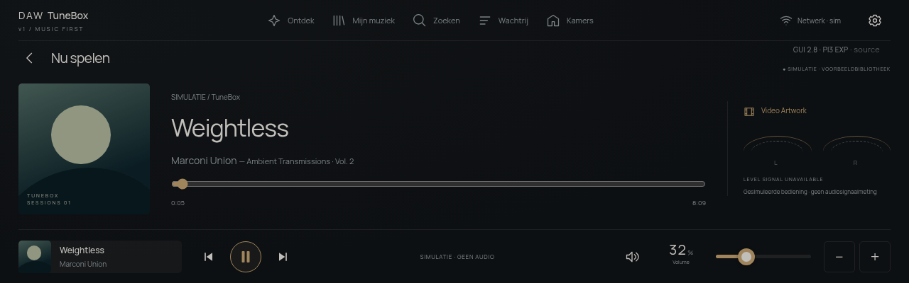

# DAW TuneBox v1 — Raspberry Pi streaming amplifier prototype

DAW TuneBox v1 aims to turn a Raspberry Pi 4 into a dedicated streaming-amplifier controller with a premium **1280 × 400 touchscreen interface**, Music Assistant playback integration and clearly modelled standby, display and safety states.

**Current release: a runnable software prototype with simulated hardware.** The interface, simulator and automated software tests are implemented. The owner has reported live Music Assistant/Squeezelite playback through a Pi 3 headphone jack. Playback reliability, kiosk performance, the Sonocotta Louder HAT and electrical protection remain under validation. No physical amplifier is enabled by this application.



*Current software screenshot using simulated playback and conceptual artwork; no Louder HAT is connected.*

## Try the simulator locally on Mac — recommended

Run the React interface and Node backend directly on macOS. **No VM, Codespace, SSH tunnel or Music Assistant server is required for simulation.** The owner reports this local Mac workflow works; this is not Pi hardware validation.

Install **Node.js 24 LTS** (the project minimum is 22.12), npm and Git. To clone this private repository, use an authorized GitHub account. With GitHub CLI installed:

```sh
gh repo clone ducasebas/daw-one-music-interface
cd daw-one-music-interface
npm ci
npm run dev
```

If GitHub CLI is missing, install it with `brew install gh` if you already use Homebrew, then sign in with `gh auth login`. Alternatively clone with Git using your existing GitHub authentication; GitHub CLI is optional.

Open one of these links **after the server starts**:

| Preview | Local development URL |
| --- | --- |
| GUI 2.0 and hardware simulator | [Open test bench](http://localhost:5173/?gui=2&lab=1) |
| Standalone responsive GUI 2.0 | [Open product](http://localhost:5173/?gui=2&product=1) |
| Exact 1280 × 400 display, centred/letterboxed | [Open display preview](http://localhost:5173/?gui=2&screen=1&display=hdmi-development) |
| Simulator shortcut | [Open demo entry](http://localhost:5173/demo.html) |

Use a full-screen browser for presentation. Skins and settings belong to the browser/origin where you save them. Switching from Codespaces or port 5173 to port 3001 does not transfer local storage automatically.

For a subsequent session:

```sh
cd daw-one-music-interface
npm run dev
```

For updates, stop the dev server with Ctrl+C, then run:

```sh
git pull --ff-only
npm ci
npm run dev
```

Frontend changes hot-reload; restart after backend/environment changes. If an old Codespaces tunnel occupies local port 5173, stop that tunnel first. Open the port actually printed by Vite.

For a production demonstration, stop the development server first:

```sh
npm run build
npm start
```

Open [production simulator](http://localhost:3001/?gui=2&lab=1) or [production display](http://localhost:3001/?gui=2&screen=1&display=hdmi-development). Rebuild after frontend changes. Stop either local server with **Ctrl+C**.

Local execution uses your Mac, not Codespaces compute. Separately **stop any running Codespace** from GitHub to stop its compute usage; closing Safari or a tunnel does not stop it. Stopped Codespaces still retain storage.

## Optional cloud simulation

[**Start TuneBox in GitHub Codespaces**](https://codespaces.new/ducasebas/daw-one-music-interface)

Open forwarded port **5173**, then append `/demo.html` or `/?gui=2&lab=1`. The repository is private: reviewers need repository access and their own Codespace. This is not an anonymous hosted demo.

If Safari downloads the forwarded address instead of displaying it, the local Mac workflow above avoids the web forwarding path. An alternative is GitHub CLI forwarding from **Mac Terminal**, while the app remains running in the Codespace:

```sh
gh codespace ports forward 5173:5173 -c YOUR_CODESPACE_NAME
```

Then open [the locally forwarded simulator](http://localhost:5173/?gui=2&lab=1). The cloud app still consumes Codespaces compute. Keep port visibility Private and do not publish mutation APIs as a workaround.

## Project name

**DAW TuneBox v1** is the current product name. **DAW ONE** is the earlier name still present in the interface, startup artwork, repository name, package, installation paths and systemd services. They refer to this same project. Existing names such as `/opt/daw-one` and `daw-one.service` remain valid; this documentation update does not migrate installed systems or replace branding assets.

## Product goals

- A focused Now Playing experience with touch, mouse and keyboard controls.
- Music Assistant integration for an external player, metadata and queue.
- Six skins, shared design tokens, saved custom themes and automatic switching.
- Display sleep independent of audio activity, with standby and presence behaviour.
- One shared application state model for the product, simulator and future hardware adapters.
- A Raspberry Pi OS Lite kiosk deployment with health checks, logs and recovery instructions.
- Physical amplifier control only after revision-specific electrical and fail-safe validation.

The intended prototype combines a Pi 4 with 2 GB RAM, a Waveshare 7.9-inch DSI display and a **Sonocotta Louder Raspberry Pi HAT**. The exact Louder variant and board revision must be confirmed; older notes mentioning “Louder HAT Plus” do not establish the selected model.

## What Music Assistant does

Music Assistant provides the music library and controls supported audio players. TuneBox supplies the product interface and device behaviour through a React frontend and Node backend; it does not embed the Music Assistant interface as an overlay.

```text
TuneBox browser UI ↔ TuneBox Node backend ↔ Music Assistant server ↔ audio player
                              ↕
                    shared device/safety model
                              ↕
                  simulated hardware (current)
```

Music Assistant needs a separately configured server and a working player. The browser itself is not the audio player. Connecting a server does not automatically validate every button, player capability, video source or physical amplifier.

## Current status

| Area | Implemented | Remaining validation |
| --- | --- | --- |
| Product UI | Now Playing, queue, settings, touch/rotary volume and six skins | Final target display, accessibility and physical touch checks |
| Themes | Shared tokens, local custom themes, day/night and state switching | Readability on the final screen |
| Virtual device | Shared state machines, scenarios, sensors, physical-button/LED preview, modules and timestamped events | Actual button, LED driver and sensors |
| Safety | Simulated fault latching, watchdog and denied enable for unverified/faulted hardware | Independent physical disable, controller firmware and electrical tests |
| Music | Mock playback, MA adapter/fixtures; owner-reported MA 2.10.9 and Pi-jack playback | Stable track changes, reconnect and measured multiroom sync; live browsing/artwork/queue edits |
| Video Artwork | Mock video clock, End-Sync arithmetic and fallback states | Real video matching, embed availability and end-to-end synchronisation |
| Startup | MP4/WebM branding, decoded-first-frame playback and fallback | Final Pi startup/decoding checks; Pi3 profile intentionally static |
| Deployment | Pi/ARM64 VM installer, experimental Pi3 profile; owner-reported HDMI kiosk | Undervoltage, cursor stutter, cold boot, recovery and final DSI/touch |
| Local Mac | Owner reports GUI 2.0 runs directly on macOS; previous UTM rehearsal is historical | Physical Safari interaction review and real Pi validation |

Software simulation does not certify physical safety, sound quality, latency or output power. Phase 5 hardware validation is **not complete**. See [recorded test evidence](docs/validation.md) and [hardware verification blockers](docs/hardware.md).

## Start in Codespaces or locally

Use **Node.js 22.12 or newer** and npm.

```sh
npm ci && npm run dev
```

Open **http://localhost:5173** locally, or the private forwarded **5173** port in Codespaces. The devcontainer can install dependencies and start the app automatically. Vite proxies backend requests to loopback port 3001. A `.env` file, Music Assistant server and hardware are unnecessary for simulation.

For subsequent starts use `npm run dev`; stop it with **Ctrl+C**. Frontend changes hot-reload. Restart after backend or environment changes.

Production preview:

```sh
npm ci
npm run build
npm start
```

Open **http://127.0.0.1:3001**. Production serves the built frontend; rebuild after changing it.

| Browser path | View |
| --- | --- |
| `/` or `/?lab=1` | Product case with separate test bench |
| `/?product=1` | Standalone responsive product |
| `/?screen=1&display=hdmi-development` | Fixed logical 1280 × 400, centred and letterboxed |
| `/?screen=1&display=dsi-production` | Native 1280 × 400 production layout |

HDMI development requires no DSI display. Both display modes use the same components, themes, APIs and playback state.

## Try the complete virtual device

1. Open the test bench. In **Controls**, select the **Playback** scenario and run it to establish a verified *simulation*.
2. Test play/pause, next/previous, seek, volume and mute. Simulation emits no real audio. Toggle Video Artwork and inspect its mock timing/manual offset.
3. Change skins or save a custom theme in Settings, then reload to check persistence.
4. Exercise standby, presence wake and display timeout. Display sleep preserves simulated audio; standby stops playback.
5. Inject temperature, power-good, amplifier or heartbeat failures. Inspect **Modules**, **States** and **Events** for transitions, enable/mute requests and reasons.
6. Restore sensor inputs and acknowledge faults. Acknowledgement leaves the amplifier off and verification revoked; run Playback again for a fresh verified simulation.

The top-of-case button and LED ring are simulated. Speaker indication requires safe simulated enable, active playback and nonzero/unmuted preview volume. L/R meters remain unavailable without actual signal telemetry.

The bench and product share the same backend state; this is not a separate demo. **Product only** opens a separate tab while the bench remains available. Settings and simulator controls use swipe pages, arrows and page pickers; narrow screens may reflow.

Settings remain editable during backend outages, but device commands require a connection. Offline telemetry is unknown, not proof of a safe live device. Production supports offline shell reload after a successful visit; development does not install that service worker.

## Safari on Mac, iPhone and iPad

Use the private Codespaces 5173 HTTPS URL while signed into the authorized GitHub account. Landscape gives more room for the product layout. Test navigation, playback, settings persistence and simulator scenarios.

For a local VM, follow the [Mac/UTM guide](docs/mac-vm.md) to access its loopback service through SSH. A host browser can provide a sharper preview than a scaled UTM window. Physical Safari, Pi graphics and touchscreen behaviour require their own checks; Linux Chromium/WebKit automation is not equivalent.

## Test and continue development

```sh
npm test
npm run build
npx playwright install --with-deps chromium
npm run test:ui
npm run test:offline
```

Optional second browser engine:

```sh
npx playwright install --with-deps webkit
npm run test:webkit
```

The historical touch-volume release passed **73 Node tests**, the full **40-case Chromium UI suite**, **19 targeted WebKit GUI/volume journeys**, **5 production/offline tests**, and the production build before publication. WebKit runs on Linux; actual iPad/Pi hardware and a real Music Assistant server remain separate validation. The 3 November publication-maintenance run passed 78 tests on each of Node 22 and 24, 41 Chromium journeys, 5 production/offline tests and the build. Dates, environment and limitations are in [validation.md](docs/validation.md).

Node coverage includes playback transitions/reconnection, protocol fixtures, End-Sync edge cases, themes, deployment policies and safety scenarios. Browser coverage includes layout, controls, persistence, offline behaviour and startup recovery.

```text
src/                 React product, themes, startup and test workbench
shared/              Shared contracts, device/safety logic, playback and End-Sync
server/              Simulation API, Music Assistant adapter and diagnostics
tests/               Domain, integration, scenario and browser tests
deploy/              Installer, kiosk, systemd units and inert hardware examples
docs/                Setup, API, verification, operations and evaluation plan
.devcontainer/       Codespaces setup and private browser preview
.github/workflows/   Automated checks
```

Keep new hardware adapters behind the shared model and deny physical enable until verification is recorded. Do not build a second disconnected simulation.

## Raspberry Pi and VM installation

Choose your target: [Pi 3 B+ experimental prebuilt installation](docs/pi3-experimental.md), [Pi 4 first-run installation](docs/pi-first-run.md), or [ARM64 UTM guide](docs/mac-vm.md). Install [system-wide Node/npm](docs/node-runtime.md) on the Linux target first. Raspberry Pi OS Lite uses a minimal Cage/Wayland/Chromium kiosk. VM installation explicitly uses `--target vm`; automatic detection rejects unknown boards.

On an installed system:

```sh
sudo /opt/daw-one/set-display-mode.sh hdmi-development
sudo systemctl enable --now daw-one-kiosk.service
cd /opt/daw-one
npm run doctor
```

Switch to `dsi-production` only when preparing the corresponding screen. The switch changes kiosk configuration, not boot wiring or hardware verification.

Doctor checks HTTP/assets and installation prerequisites; it does not prove visible pixels, audible output or electrical safety. Use `npm run doctor -- --require-ma` to require a live Music Assistant transport connection. Local guides are available at `/docs/` and `/opt/daw-one/docs/`.

See [display modes](docs/display-modes.md) and [Pi operations/recovery](docs/raspberry-pi.md). Early Linux boot concealment, physical backlight gating and persistent VM resolution are not certified by the application splash.

## Live Music Assistant setup

Follow [Music Assistant setup](docs/music-assistant.md). Configure the server on the backend, select a player explicitly and enable controls only when ready; live control defaults to read-only. Connecting does not automatically start playback or change volume. Installed systemd configuration uses the documented system paths, not merely a repository `.env`.

Verify real metadata, queue updates, volume/mute, play/pause, reconnect and seek where the selected player supports it. A successful connection alone is not an audio or complete-interface acceptance test.

## Sonocotta development sample

We would like to evaluate a Louder HAT and produce a reproducible integration guide, honest test results, issue reports and a short demonstration. A development sample would allow the physical audio work that simulation cannot validate.

Read the [evaluation plan and draft sample request](docs/sonocotta-evaluation.md) for manufacturer questions, staged acceptance evidence and proposed deliverables. The owner reports that Sonocotta agreed to provide a development sample; receipt and the delivered revision are not yet confirmed. No endorsement or completed HAT validation is implied. A demonstration video is optional for initial outreach; screenshots and a clear explanation are also suitable. The repository is MIT-licensed and prepared for publication; its GitHub visibility still needs to be switched from private to public. See the [publication review](docs/publication-review.md).

## Next concrete tasks

1. Review the refined GUI 2.0 skins on the target screen. Use Settings → Skins: Reference Dark, Minimal Dark, Warm Bronze, Champagne Gold, Cinematic and Nerd Mode now have distinct materials/presentation and shared SVG controls; Nerd adds real available simulation diagnostics.
2. Complete daily-use interaction states: empty/loading/failure, clear command outcomes, accessibility and responsive/low-resource checks.
3. Connect Music Assistant on the NUC for real library/search/artwork/favourites/queue operations and Spotify/Tidal discovery workflows. Current example content is not that integration.
4. Make the owner-reported Squeezelite/Rivo group playback reproducible; measure delay/drift, track changes and recovery. The UI grouping example itself is not a live grouping control.
5. Validate Pi kiosk, DSI/touch and supported audio on real hardware; confirm the Sonocotta Louder SKU/revision and documentation.
6. Implement and measure controller, power and mute protection before permitting physical amplifier enable. Real Video Artwork matching/embedding remains separate work.

Additional references: [API/protocol](docs/protocol-and-api.md), [hardware release gate](docs/hardware.md), [validation history](docs/validation.md).

## Troubleshooting

- **Blank/unavailable page:** start `npm run dev` and use port **5173**. Port 3001 may serve an older production build. The loading shell and React error boundary expose startup failures.
- **Latched amplifier fault:** restore simulated inputs, acknowledge, then run a fresh Playback scenario. Refreshing the browser does not clear backend faults.
- **No startup animation:** reduced-motion intentionally uses a still. Otherwise WebM/MP4 playback falls back to a logo fade if unavailable; **Replay startup** does not reboot or enable hardware.
- **Private guide inaccessible on GitHub:** use the installed app's `/docs/` page or local files.
- **No sound in simulation:** expected. Real sound requires a configured Music Assistant player and validated audio hardware.

## GUI 2.0 preview

**Touch volume:** Settings → General → Volume control selects a wide touch slider or circular dial. Both support keyboard/fine steps, larger touch targets and commit on release; the interface separates preview/pending values from confirmed player volume. The choice persists locally. GUI 1.0 keeps its earlier reference control.

**Check the running version:** the GUI 2.0 header and testbench show **GUI 2.8 · PI3 EXP** plus Git revision when available. Hover for build details. Missing or mismatched backend release information is flagged. If the marker is absent, the new frontend has not loaded. After pulling, restart the server and reload; production also requires a rebuild. The old display-r3 string is only a diagnostics marker.

Open **`/?gui=2&product=1`** for the new music-first interface, or **`/?gui=2&lab=1`** to keep the shared hardware workbench visible. The existing GUI remains available. Discover/library content is labelled as example data; playback and queue actions use the same simulator backend. Rivo grouping is a visual example, not a connected player. See [preview, SVG icons and skin contribution guide](docs/gui-2-preview.md).

## Available Pi hardware and image status

The available board is a **Pi 3 Model B+ (1 GB)**. An explicit [experimental Pi 3 mode](docs/pi3-experimental.md) now supports a Mac-built release bundle, static artwork and reduced effects. It has owner-reported basic Pi-jack/HDMI operation, with unresolved power, cursor and playback reliability issues. Pi3 B+/Pi4 are now automatically detected. There is **no flashable TuneBox OS image**.

## Review and participation

See the [owner-reported Pi/audio field test](docs/field-test-2026-11-01.md), [optional audio bench setup](docs/pi-audio-bench.md), [publication review](docs/publication-review.md), [security boundaries](SECURITY.md), [contribution guide](CONTRIBUTING.md) and [asset/dependency notices](THIRD_PARTY_NOTICES.md). The project’s own software and documentation use the [MIT licence](LICENSE). Dependencies and separately identified assets retain their own terms. The owner has confirmed permission to publish the supplied reference/startup images; see the notices.

## Automatic Pi setup and hardware proposal

The installer now detects Pi3 B+ (lightweight, prebuilt-only) or Pi4 automatically. A local Music Assistant server is optional and offered only after a conservative Pi4 resource/health check; never on Pi3. See [co-hosting policy and install options](docs/local-music-assistant.md). The [I/O layout](docs/hardware/io-layout-proposal.md) is unverified source material; read [its review](docs/hardware/io-layout-review.md). The [boot-flow proposal](docs/boot-flow-proposal.md) is for discussion before skins/boot/autoplay implementation.
