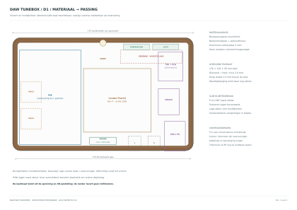

# TuneBox D1 — publicatie en nominale pascontrole

**De volledige gegenereerde D1-bestandenset is gepubliceerd op 11 november 2026.** De tijdelijke blokkade van de werkruimte is verholpen. De nominale pascontrole is uitgevoerd op 10 november 2026.

Ga naar [materiaalopbouw, 3D-passing, bronnen en beperkingen](fit-d1.md) voor de volledige uitwerking.

- [Technische tekening — drie A3-bladen PDF](fit-d1.pdf)
- [CAD-pakket — onze kastgeometrie en benoemde referentievolumes](fit-d1-cad.zip)
- [Eigen STEP met kast en reserveringen](fit-d1-case-and-reservations.step)
- [STL van de prototypekern](fit-d1-core.stl)
- [Plaatsingstekening](fit-d1-layout.svg), [doorsnede](fit-d1-section.svg) en [1:1 contourtemplate](fit-d1-template.svg)
- [Technische 3D-illustratie](fit-d1-cad-preview.png)
- [Controleverslag](fit-d1-check.json), [onderdelen](fit-d1-parts.json) en [bronmanifest met SHA-256](fit-d1-sources.json)
- [Generatoren en instructies](../../design/mechanical/README.md)

## Uitkomst en grenzen

Het pasmodel meet **176 × 110 × 45 mm**, exclusief wandophanging. Bestaand schermglas, berkenmultiplex met walnootfineer en een technische aluminium achterplaat vormen de materiaalbasis. Pi en HAT liggen naast elkaar. MDF is bruikbaar voor een pasmodel.

De nominale controle omvatte **31 CAD-objecten/reserveringen, 66 solid-intersectieberekeningen en nul onverwachte volume-overlappingen**. De Pi, enkele componenten en stekkers zijn expliciete reserveringen. De gedistribueerde STEP bevat onze kastgeometrie en referentievolumes; fabrikant-STEP wordt niet onder onze projectlicentie heruitgegeven.

Bevestiging, volledige kabelroute, geleverde revisies en fysieke pasproef volgen nog. Thermische werking, ontvangst, sterkte en productietoleranties zijn niet op het complete apparaat gevalideerd. **Dit is geen vrijgegeven productie- of CNC-tekening.**

Het [eerdere openbare plaatsingsschema](fit-d1-overview.svg) blijft als eenvoudig overzicht beschikbaar. De hierboven gekoppelde originele D1-tekeningen en het controleverslag zijn de volledige uitwerking.
