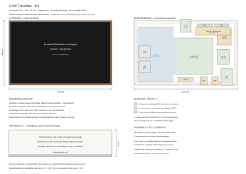

# TuneBox D1 — nominale binnenindeling

De materiaalgestuurde binnenindeling is op 10 november 2026 uitgewerkt en gecontroleerd. **Dit is een pasmodel, geen vrijgegeven productieontwerp.** De volledige CAD- en tekeningenupload is nog niet voltooid doordat de uitvoerwerkruimte niet meer start.

[Open het SVG-plaatsingsschema](fit-d1-overview.svg). Dit openbare overzicht is opgebouwd uit de vastgelegde maten en plaatsingen. Het toont rechthoekige omhullenden, geen exacte fabrikantcontouren, complete CAD-assemblage of boorpatroon. De werkelijke solid-controle is afzonderlijk uitgevoerd zoals hieronder beschreven.

## Pasmodel en materiaal

| Onderdeel | D1 |
| --- | --- |
| Kast, exclusief ophanging | 176 × 110 × 45 mm |
| Bestaand schermglas | 170,18 × 104,20 mm |
| Extra houten kant buiten het glas | 2,91 mm links/rechts; 2,90 mm boven/onder |
| Materiaalbasis | Berkenmultiplex met walnootfineer; MDF kan voor een pasmodel |
| Kernwand achteraan | 4 mm nominaal |
| Afwerkingsruimte | 0,8 mm voor fineer, drager, lijm en coating |
| Achterplaat | Aluminium, 3 mm als prototypekeuze |
| Knop boven de kast | 1,5 mm volgens het gebruikte CAD-model |
| Status | Pasmodel; geen definitieve productie- of CNC-maat |

Het bestaande touchglas vormt de zichtzijde. Pi en HAT liggen naast elkaar. Temperatuur- en lichtsensor liggen bij de bovenwand, versprongen in diepte om QT-stekkers vrij te houden. Lage aansluitdelen gebruiken plaatselijk ruimte vóór de hoofdprinten; er is projectie-overlap van enkele losse delen, maar geen onverwachte volume-overlap in het gecontroleerde model.

De frontuitsparing volgt de werkelijke schermmodule en is geen overal gelijk rechthoekig gat. De fineerafwerking bij de hoeken moet met materiaalproeven en eventuele naden worden uitgewerkt; de boog in de render bewijst geen haalbare fineerbuigradius.

## Uitgevoerde controle

De geslaagde run omvatte **31 CAD-objecten/reserveringen, 66 solid-intersectieberekeningen en nul onverwachte volume-overlappingen**. Daarnaast werden 386 paren op begrenzing uitgesloten en 44 op bewezen ligging binnen de uitgefreesde holte. Bedoelde insteekverbindingen zijn afzonderlijk behandeld.

De controle gebruikte echte STEP-geometrie van:

- [Waveshare 7inch DSI LCD (E), SKU 29112](https://www.waveshare.net/w/upload/5/59/7inch_DSI_LCD_%28E%29_20250428_stp.zip): 25 vaste delen, totale omhullende **170,18 × 104,20 × 15,30 mm**. De eerdere 22 mm was een reservering. [Fabrikanttekening](https://www.waveshare.net/w/upload/f/ff/7inch_DSI_LCD_%28E%29-20250428.pdf).
- [Sonocotta Louder HAT Plus1X Rev F](https://github.com/sonocotta/raspberry-media-center/tree/main/hardware/5-Louder-Plus/Rev%20F%20-%201X%20Hat): publieke fabrikant-CAD. De geleverde F1-revisie moet ermee worden vergeleken.
- [Adafruit CAD Parts](https://github.com/adafruit/Adafruit_CAD_Parts): HUSB238 product 5991, INA228 product 5832 en RGB-knop product 3350.

De Pi was een conservatieve omhullende van 92 × 60 × 22 mm, geen fabrikant-STEP. Kleine sensorprinten gebruikten Eagle-geometrie, connector-CAD en componentreserveringen. Kabelpluggen, carrier, radarhouder en losse aansluitdelen waren expliciete reserveringen. De uitslag certificeert die fysieke onderdelen niet.

Het knopmodel en de catalogus verschillen in buitenmaten; voor de moer is afzonderlijk 22 mm ruimte gereserveerd. De carrier is een plaatsreservering, geen ontworpen schakeling. Een gereserveerde kabelzone bewijst geen complete FPC-route of geldige buigradius.

## Wat nog volgt

Volgens de [ontwerpvolgorde](design-workflow.md) volgen nu bevestiging en montagevolgorde, de volledige kabelroute en een fysieke pasproef. De wens is twee schroeven per hoofdprint, waar nodig aangevuld met steunpunten. Schermbevestiging en wandophanging zijn nog niet ontworpen.

Vooral FPC-buigradius, de daadwerkelijke zekeringhouder, paneelklemmen, geleverde revisies en de carrierindeling moeten worden gecontroleerd. Warmteafvoer, ontvangst en mechanische sterkte zijn nog niet op het complete apparaat gevalideerd.

**176 × 110 × 45 mm is daarom geen bewezen minimum of definitieve zaagmaat.** Wandafstand en ophanging zijn nog niet definitief.

## Status van bestanden

In de werkruimte zijn de driebladige PDF, SVG-tekeningen, het controleverslag, de eigen STEP/STL-geometrie, het CAD-pakket en een technische CAD-illustratie gegenereerd. De publicatie van die volledige bestanden is nog open. Het bovenstaande openbare overzicht vervangt die bestanden niet.

De genoemde controle is uitgevoerd vóór de werkruimtefout; de fout is geen mislukte geometrische test. Geen fabrikant-STEP is onder de projectlicentie heruitgegeven. Deze documentatie wijzigt geen Pi-installatie, GPIO-aansturing of versterkerverificatie.

### Vastgelegde bronhashes

| Bronbestand | SHA-256 |
| --- | --- |
| Waveshare 7inch-DSI-LCD-E-20250428.stp | `6ae28f717897efab9b3c5bbf295390e8bff136a998184d07676ef3ff85d00ecf` |
| Louder Plus1X Rev F STEP | `84f0732614c575a98365861e74376fbf0b549f508ee53a1ba808341e6a04e75e` |
| Louder Plus1X Rev F gerber/drill ZIP | `4180911765cae9858c0ebc0dc99ede6023af11d5d3cf051f119f3a10f778c8ac` |
