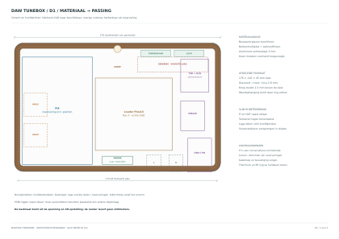
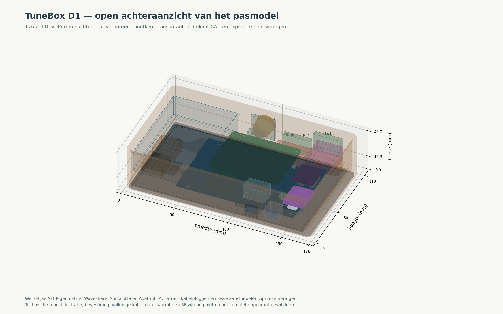
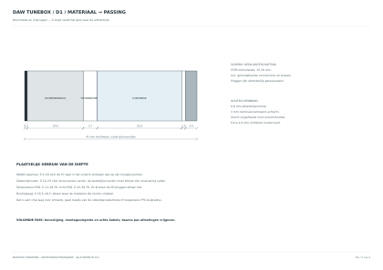

# TuneBox D1 — materiaalopbouw en nominale 3D-passing

Stap 3 van de [ontwerpvolgorde](design-workflow.md). Uitgangspunt: het bestaande Waveshare-touchglas, een berkenmultiplex drager met walnootfineer en een aluminium achterplaat. MDF kan voor een pasmodel worden gebruikt; de uitwerking hieronder gebruikt multiplex. Er is geen metalen voorrand toegevoegd.

[Technische tekening: 3 bladen PDF](fit-d1.pdf) · [Doorsnede SVG](fit-d1-section.svg) · [1:1 contourtemplate](fit-d1-template.svg) · [Eigen CAD en STL in ZIP](fit-d1-cad.zip) · [Controleverslag](fit-d1-check.json)

De uitgevoerde controle omvatte **31 CAD-objecten/reserveringen, 66 solid-intersectieberekeningen en nul onverwachte volume-overlappingen**. De reikwijdte en de nog niet gecontroleerde eigenschappen staan hieronder en in het verslag.

## Uitkomst voor het pasmodel

| Maat of laag | D1 |
|---|---|
| Kastbreedte × hoogte × diepte | 176 × 110 × 45 mm |
| Bestaand schermglas | 170,18 × 104,20 mm |
| Houten kant buiten het glas | 2,91 mm links/rechts; 2,90 mm boven/onder |
| Achterste kernwand | 4 mm als constructiekeuze voor dit pasmodel |
| Fineer, dragerpapier, lijm en afwerking samen | 0,8 mm gereserveerd; controleren aan het materiaalstaal |
| Voorste houten rand | Vrijgefreesd rond de werkelijke schermmodule; geen overal even dikke rechte wand |
| Aluminium achterplaat | 3 mm, onbewerkte montageplaat zonder vrijgegeven bevestigingsgaten |
| Knop boven de kast | 1,5 mm volgens het gebruikte knopmodel |
| Wandafstand / ophangsysteem | Nog niet onderdeel van de definitieve maatvoering |

Dit is de maat van een **pasmodel**, niet een bewezen minimum of vrijgegeven productiemaat. De kastmaten volgen uit de schermgeometrie, materiaalruimte en nominale opstelling. De 190 × 124 mm uit C1 is hiervoor niet als vaste invoer gebruikt. De zichtbare houten kant is een gevolg van deze opbouw, geen nieuw los bezelprofiel.

## Het echte schermmodel is gebruikt

De officiële [Waveshare 7inch DSI LCD (E) STEP-download](https://www.waveshare.net/w/upload/5/59/7inch_DSI_LCD_%28E%29_20250428_stp.zip) is ingelezen. Het model bestaat uit 25 vaste delen en heeft een totale omhullende van 170,18 × 104,20 × 15,30 mm. Die laatste maat omvat de gemodelleerde connectoren en montagebussen, maar geen aangesloten kabelstekkers. De eerdere 22 mm was slechts een reservering.

Het model is in dieptelagen onderzocht. Direct achter het 0,7 mm glas verandert het contour: een houten mantel heeft dus een sponning nodig in plaats van één rechthoekig gat op glasbreedte. De sponning en de grotere achterste holte zijn als verschillende volumes gemodelleerd. Er wordt geen extra glas over het touchscreen gelegd.

## De plaatsing

Pi en HAT staan naast elkaar. De Pi-componentzijde wijst naar de achterplaat, zodat een passende thermische verbinding met de SoC mogelijk blijft. De HAT-componenten wijzen naar het scherm. Hun onderlinge elektrische aansluiting wordt niet door een automatische configuratiewijziging uit deze tekening gemaakt.

PCT2075 en TSL2591 liggen tegen de bovenwand. De lichtsensor kan daardoor rechtstreeks via een korte lichtgeleider naar boven kijken. Beide printen zijn in de diepte versprongen: zo hebben tegenover elkaar liggende QT-stekkers een eigen plaats. De temperatuurprint is geen sensor voor de chiptemperatuur van de versterker.

De lage WAGO-reserveringen liggen vóór de Pi, waar de schermmodule minder diep is dan op zijn hoogste punten. De zekeringhouder heeft een eigen voorste laag vóór de voedingscarrier. De radar is haaks op de achterplaat bij de onderwand gereserveerd; het antennezicht door de uiteindelijke wand moet nog worden getest. De verborgen luidsprekeraansluitingen liggen in een andere dieptelaag dan de radar. Dit bespaart oppervlak zonder Pi en HAT op elkaar te stapelen.

De aparte routinglaag is een vrije ruimte voor de verdere kabeluitwerking. Zij bewijst niet dat een 20 of 30 cm FPC-kabel met zijn vereiste buigradius al volledig is ingepast. De losse GPIO-, voedings- en QT-kabels moeten in stap 4 en het pasmodel daadwerkelijk worden gelegd.

## Welke onderdelen zijn echt CAD en welke zijn reserveringen?

| Onderdeel | Controlebasis |
|---|---|
| Scherm, Louder Plus1X RevF, HUSB238 Adafruit5991, INA228 Adafruit5832, RGB-knop Adafruit3350 | Fabrikant-STEP, lokaal gebruikt in de 3D-controle |
| Pi4 | Conservatieve ruimte van 92 × 60 × 22 mm, gebaseerd op de officiële print-/poortmaten met ruimte voor SD en aansluitingen; geen fabrikant-STEP van de Pi |
| PCT2075 en TSL2591 QT | Eagle-printgeometrie en componentposities, echte JST-behuizingen uit hetzelfde Adafruit-pakket, overige componenten als hoogte-enveloppen |
| QT-, schermvoedings-, GPIO- en DC-stekkers | Expliciete stekkerreserveringen; vergelijken met de gebruikte kabels |
| Zekeringhouder | 60 × 13 × 13 mm inclusief beperkte draaduittrede. Een [Littelfuse150-body van 47,5 ±1 mm, Ø11 mm](https://m.littelfuse.com/~/media/electronics/datasheets/fuse_holders/littelfuse_fuse_holder_150_datasheet.pdf.pdf) is een passende referentiemaat; stroomwaarde en volledige beveiliging zijn hiermee niet gekozen |
| WAGO-verdeling | Twee reserves van 20 × 20 × 9 mm; klemmen worden vóór de Pi aangesloten en zijn na verwijderen van de Pi bereikbaar |
| TSR/ULN-carrier | Reserve 24 × 28 × 13 mm; geen al ontworpen en geteste voedingsprint |
| Luidsprekerklemmen en radarhouder | Reserveringen; paneelklemtype, RF-prestaties en bevestiging nog uitwerken |

De knop is een voorbeeld van een bronverschil dat niet wordt weggepoetst: Adafruit noemt 22 × 22 × 19,5 mm op de productpagina, terwijl het STEP-model zonder losse moer 18 × 18 × 21,5 mm meet. Daarom is de diepte van het model én een afzonderlijke ruimte voor de moer meegenomen. Het geleverde onderdeel blijft onderdeel van de pascontrole.

## Wat de controle betekent

Het [JSON-verslag](fit-d1-check.json) vermeldt per object zijn herkomst en begrenzing. Vaste delen worden eerst op omhullende getoetst en daarna, waar nodig, met echte solid-intersecties. Wiskundig bewezen ligging binnen de uitgefreesde holte voorkomt onnodige CAD-berekeningen. Bedoelde insteekgebieden, zoals een kabelplug in zijn connector, zijn afzonderlijk benoemd.

Een uitslag zonder onverwachte volume-overlap geldt voor deze nominale modellen en reserveringen. Het is geen bewijs van productietoleranties, mechanische sterkte, alle kabelbochten, thermische werking of ontvangst. Vooral de werkelijke kabels, carrierindeling, geleverde revisies en luidsprekerklemmen kunnen nog wijzigingen vragen.

De volgende stap is de bevestiging: het scherm krijgt een eigen drager, de hoofdprinten hun montagepunten en de achterplaat een bereikbaar ophangsysteem. Lange bussen rechtstreeks vanaf alle schermgaten naar de achterplaat mogen niet zomaar door de printlagen worden getrokken. Het schermmodel maakt die mogelijke botsingen zichtbaar. Daarna volgt een volledige pasproef voordat iemand de behuizing laat maken.

## Bestanden en herhaalbaarheid

[fit_d1.py](../../design/mechanical/fit_d1.py) bouwt de geometrie en het controleverslag; [preview_fit_d1.py](../../design/mechanical/preview_fit_d1.py) maakt een technische CAD-illustratie. [Bronnen en SHA-256](fit-d1-sources.json) leggen de ingelezen bestanden vast. De ZIP bevat alleen onze kastgeometrie en benoemde referentievolumes. Vendor-STEP-bestanden worden niet onder de projectlicentie heruitgegeven. De download is geen CNC-vrijgave.
