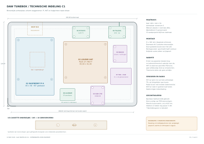

# TuneBox C1 — maatvaste indeling voor de pasproef

**Status bijgesteld op 10 november 2026: bewaarde verpakkingsstudie.** De bronmaten en berekeningen blijven naslag. De eigenaar heeft de volgorde render → materialen → binnenmaatvoering/plaatsing → bevestiging vastgesteld. De kastmaat en constructie uit C1 zijn geen goedgekeurde ontwerpbesluiten; volg de [actuele ontwerpvolgorde](design-workflow.md). De historische tekst en bestanden hieronder zijn niet de vrijgegeven bouwbasis.

10 november 2026. Pi en Louder HAT staan naast elkaar op de aluminium achterplaat. De openbare fabrikantbestanden zijn opgezocht; de eigenaar hoeft die niet opnieuw aan te leveren. Dit vervangt het schematische montageconcept B als basis voor de mechanische pasproef.

[Technische tekening, 3 bladen PDF](wall-rear-layout.pdf) · [SVG](wall-rear-layout.svg) · [1:1 montagesjabloon](wall-mount-template.svg) · [DXF met positioneerharten](wall-mount-template.dxf) · [Montagecoördinaten CSV](wall-mount-centres.csv) · [STEP met reserveringsvolumes](wall-layout-envelopes.step)

De STEP bevat benoemde blokken voor vrije ruimte, geen gedetailleerde fabrikantmodellen. De achterplaat is een onbewerkte blank; de DXF bevat referentielijnen en montageharten, geen vrijgegeven boor- of tapdiameters. Het PDF-sjabloon op blad 3 heeft schaal 1:1 bij afdrukken op 100%; controleer de 50 mm maatbalk. De eerste twee bladen zijn passend op A3 gezet, niet op schaal 1:1.

## Vastgelegde bronmaten

| Onderdeel | Bronmaat in mm | Herkomst |
|---|---|---|
| Raspberry Pi 4 PCB | 85 × 56; raster 58 × 49 | [Officiële datasheet, release 1.1, figuur 1](https://pip-assets.raspberrypi.com/categories/545-raspberry-pi-4-model-b/documents/RP-008341-DS-1-raspberry-pi-4-datasheet.pdf) |
| Louder HAT Plus 1X Rev F PCB | Omhullende circa 65,00 × 61,38; 1,60 dik | [Sonocotta STEP](https://github.com/sonocotta/raspberry-media-center/blob/main/hardware/5-Louder-Plus/Rev%20F%20-%201X%20Hat/2601-louder-raspberry-hat-plus-1x-f.step), PCB-solid afzonderlijk ingelezen |
| Louder Rev F montagegaten | Circa 58 × 49 raster; boorgat Ø3,048 | [Gerber/drill ZIP](https://github.com/sonocotta/raspberry-media-center/blob/main/hardware/5-Louder-Plus/Rev%20F%20-%201X%20Hat/2601-louder-raspberry-hat-plus-1x-f.zip), `Drill_PTH_Through.DRL`, gereedschap T05 |
| Louder Rev F gemodelleerde componenten | Omhullende circa 65,83 × 62,03 × 11,21 | Volledige STEP-assemblage. Dit is geen aangesloten-stekkerenvelop en bewijst geen correcte F1-fit |
| Waveshare 7inch DSI LCD (E), SKU 29112 | Glas 170,18 × 104,20; zichtbaar venster 151,80 × 95,10 | [Officiële maattekening 2025-04-28](https://files.waveshare.com/wiki/7inch-DSI-LCD-%28E%29/7inch_DSI_LCD_%28E%29-20250428.pdf). Venstermaat is niet hetzelfde als actieve LCD-matrix |
| HUSB238 switchable PD PCB, Adafruit 5991 | 20,32 × 27,813 | [Eagle PCB](https://github.com/adafruit/Adafruit-USB-Type-C-PD-Switchable-PCB/blob/main/Adafruit%20USB%20Type%20C%20PD%20Switchable.brd), outline layer 20 |
| INA228 PCB, Adafruit 5832 | 25,40 × 20,32 | [Eagle PCB](https://github.com/adafruit/Adafruit-INA228-PCB/blob/main/Adafruit%20INA228%20I2C%20Power%20Monitor.brd), outline layer 20 |
| PCT2075 PCB, Adafruit 4369 | 25,40 × 17,78 | [Eagle PCB](https://github.com/adafruit/Adafruit-PCT2075-PCB/blob/master/Adafruit_PCT2075.brd), outline layer 20 |
| TSL2591 STEMMA QT PCB, Adafruit 1980 | 25,40 × 17,78 | [Eagle PCB](https://github.com/adafruit/Adafruit-TSL2591-Breakout-PCB/blob/master/Adafruit%20TSL2591.brd). Het oude niet-QT model is niet gebruikt |
| Seeed 24 GHz mmWave for XIAO | 18 × 22 module | [Seeed documentatie](https://wiki.seeedstudio.com/mmwave_for_xiao/); de gereserveerde RF-pocket is nog geen geteste antenneplaatsing |

De HAT is dus niet als een generieke 65 × 56 HAT getekend: zijn uitstekende PCB-rand is meegenomen. De publiek beschikbare tekening is Rev F; de eerder door de maker genoemde F1 geldt niet automatisch als geometrisch identiek. Voor de CNC-vrijgave hoort de geleverde print op het sjabloon te worden gelegd. Dat is een pascontrole, geen verzoek om beschikbare CAD opnieuw op te meten.

## Gekozen constructie

Het bestaande exterieur blijft 190 × 124 mm. De ontwerpdiepte blijft 50 mm voor de kast plus voorlopig 5 mm voor ophanging. Die 55 mm wandprojectie is een doelmaat; ventilatie en het gekozen ophangsysteem kunnen meer afstand vragen. Walnoot zijwand 5 mm en aluminium achterplaat 3 mm zijn constructiekeuzes. De frontglasrand houdt rondom ongeveer 9,9 mm over.

De Pi staat 90° gedraaid met USB/Ethernet naar onderen. Deze Pi-poorten zijn voor service bij geopende kast; een aangesloten Ethernetstekker past niet automatisch in deze reservering. De HAT staat rechts van de Pi. Beide krijgen twee diagonale M2,5 bevestigingen en twee passieve steunvoetjes. Er lopen geen gedeelde bouten door scherm, Pi en HAT. De LCD-module blijft op een eigen frontdrager; de achterplaat gebruikt de schermgaten niet als universeel elektronicapatroon.

Gebruik bij voorkeur geschroefde montagevoeten. Als montagevoeten met epoxy op de plaat worden gelijmd, blijft de print zelf losneembaar. Lijmsoort, hechtoppervlak, oppervlaktetoestand, warmte en afpelbelasting moeten op een proefstuk worden gecontroleerd. Gewone kleine zeskantbusjes op alleen hun kopvlak lijmen is geen onderbouwde constructie voor een wandapparaat. Printen niet direct met epoxy vastzetten.

De kleine printen staan op hun eigen plek. De TSR/ULN/protectiecarrier heeft een gereserveerd vlak van 31 × 24 mm; zijn schakeling is nog niet getekend. De I/O-cassette van 105 × 18 mm ligt onderaan met L, USB-C en R. De positie is vastgelegd; gaten voor nog niet gekozen luidsprekerklemmen en de USB-C-insteekkamer zijn niet verzonnen. Die kunnen later met de cassette worden aangepast zonder de gehele achterplaat opnieuw te maken. BTL-luidsprekeruitgangen moeten ten opzichte van de metalen plaat geïsoleerd blijven.

## Warmte en diepte

De Pi-componentzijde wijst naar de achterplaat. Het voorstel gebruikt een PCB-onderzijdedatum op 18 mm van de binnenzijde van de plaat, zodat de hoge USB/Ethernetcomponenten vrij kunnen blijven. Een metalen warmtebrug verbindt de SoC met de plaat via een geschikt thermisch raakvlak. De getekende warmtebrugzone is indicatief; contactvlak, vlakheid, elektrische isolatie, hoogte en druk worden bij de pasproef vastgesteld. Niet meerdere dikke pads stapelen om een grote luchtspleet te overbruggen.

De HAT staat met de componenten naar het scherm en de PCB-onderzijde voorlopig 6 mm van de plaat. Een eventuele verbinding tussen geschikte koper-/thermische PCB-zones en de achterplaat moet op de werkelijke HAT worden ontworpen. Het STEP-model bewijst niet dat een willekeurig vlak veilig tegen aluminium kan worden gedrukt. De maximale versterkerbelasting kan pas na thermische tests worden bepaald.

Het dieptebudget is: 3 mm aluminium + 22 mm elektronicareservering + 3 mm vrije ruimte + 22 mm schermreservering = 50 mm. De 22 mm voor het scherm is een gekozen keep-out, geen uit de officiële tekening overgenomen dikte. Schermprint, montagebussen, voedingstekker en DSI-bochten moeten daarin daadwerkelijk passen. Daarom wordt 50 mm niet als bewezen minimum of productieklare maat gepubliceerd.

PCT2075 staat op nylon, met afstand tot thermische bruggen: hij meet interne lucht, niet de SoC- of versterkerchiptemperatuur. TSL2591 krijgt een lichtgeleider naar boven. Radar krijgt een afzonderlijke pocket bij een niet-metalen bodemvenster. Controleer Wi-Fi-ontvangst en radar met gemonteerde aluminiumplaat en LCD; alleen een leeg PCB-vlak vrijhouden bewijst geen RF-prestatie.

## Wat is gecontroleerd, wat volgt in de proefbouw?

Het [controleverslag](wall-layout-check.json) controleert de rechthoekige PCB-reserveringen, montagecoördinaten, kastgrenzen, onderlinge afstand en het nominale dieptebudget. Kleinste afstand tussen de PCB-reserveringen: 3,999 mm. De geïmporteerde HAT-componenten steken iets buiten de PCB-omhullende uit; plaatsingsruimte voor componenten is niet gelijk aan kabelruimte.

Vóór fabricage volgen één volledige mechanische pasproef met stekkers, afstandsbussen en scherm, de thermische belastingtest, RF-test en de keuze van echte paneelklemmen/ophanging. Controleer ook soldeerpunten, schroefkoppen, gereedschapstoegang, DSI/QT-kabelbochten, trekontlasting en veilige voedingsbedrading. De bestaande conceptkeuze voor een losse zekeringhouder, Wago-verdeling en DC-stekker is nog niet als 3D-component ingepast; de voedingscarrier en kabelcorridors moeten hiermee samen worden uitgewerkt. Deze tekening wijzigt geen bootconfiguratie, GPIO-aansturing of status van versterkerverificatie.

De open ontwerpbestanden zijn [layout.json](../../design/mechanical/layout.json) en [build_layout.py](../../design/mechanical/build_layout.py). Het script maakt de tekeningen opnieuw; afhankelijkheden zijn Python, ReportLab, PyMuPDF en voor STEP CadQuery. Vendorbestanden worden niet onder de projectlicentie heruitgegeven; bron-URL's en controlesommen staan in de parameters.
