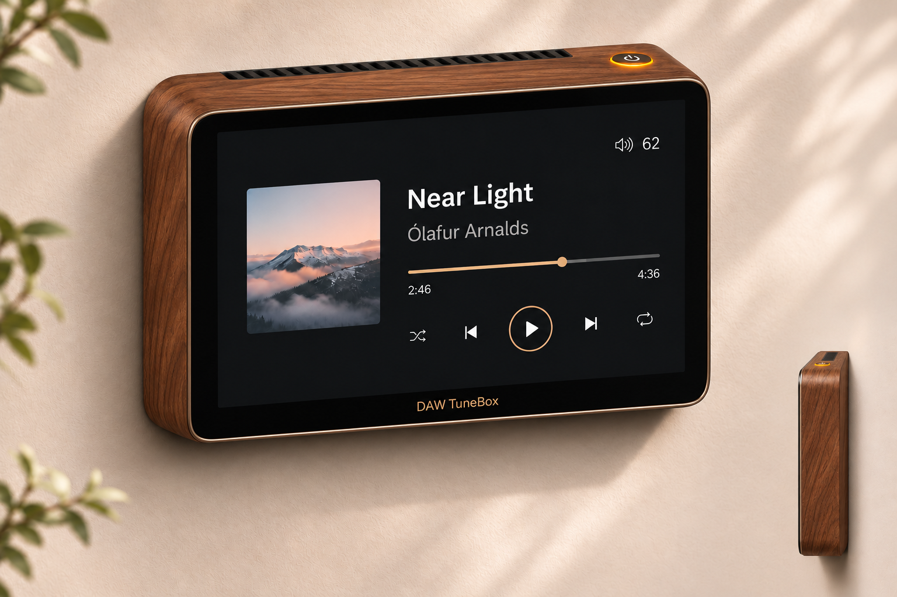
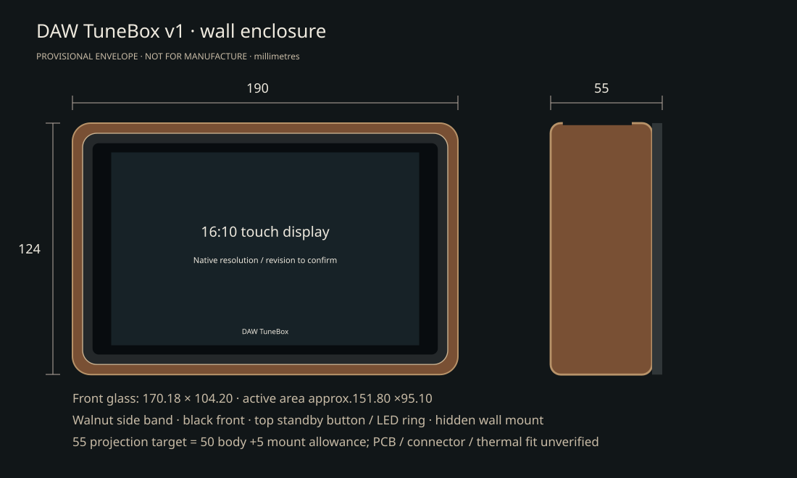

# DAW TuneBox v1 — approved visual direction

Status revised10 November 2026: the render establishes appearance. Follow the owner's [design sequence](design-workflow.md): render, materials, internal fit/dimensions, then mounting. A metal edge profile and final enclosure size have not been selected. Native1280×800 resolution is confirmed; the product description matches [Waveshare7inch DSI LCD (E), SKU29112](https://www.waveshare.com/7inch-dsi-lcd-e.htm).

The public manufacturer CAD has been collected for the screen, Pi4, Louder Plus1X RevF and the Adafruit sensor/power PCBs. **[C1 source dimensions and packing study](wall-mechanical-c1.md)** remain reference material. C1 does not set the approved enclosure, material stack or final mounting positions.

The render shows a wooden side band around the depth of the enclosure, a black glossy front, rounded corners and a fine warm-coloured line along the front. That line is a visual finish, not evidence of a chosen metal profile. Hidden wall bracket and cables, no feet, no physical volume knob. One physical standby pushbutton with LED ring on top; vent insert at top rear. Wood construction, front layers, edge finish and rear-plate material are addressed in the material stage before the dimensional layout is frozen.

## Historical packing assumptions — not approved dimensions

The table below records the previous C1 study. Neither its190×124mm footprint nor the later proposed175×109mm footprint is a selected exterior size. Neither10mm nor2–3mm additional bezel is an approved requirement. Material stack, full internal fit and mounting determine the dimensions in that order.

| Item | Provisional size / decision | Evidence / status |
|---|---|---|
| Overall width × height | 190 × 124 mm | Proposed packaging target; prototype validation required |
| Body depth | 50 mm | Proposed starting allocation, not a validated minimum |
| Wall mounting allowance | 5 mm | Proposed; bracket/cable bend geometry unverified |
| Total wall projection | 55 mm | Body plus mounting allowance; may increase after thermal/connector layout |
| Screen cover glass | 170.18 × 104.20 mm | Transcribed from owner's new supplier screenshot; delivered revision and physical drawing fit not yet verified |
| Cover-glass visible window | 151.80 ×95.10 mm | Waveshare drawing2025-04-28; lens aperture, not an active-pixel-area measurement |
| GUI panel | 16:10; 1280 ×800 logical pixels | Native resolution confirmed by owner; matches manufacturer1280×800 specification |
| Front surround | approx.9.91 mm left/right;9.90 mm top/bottom outside glass | Arithmetic from proposed envelope, not screw/glass assembly tolerances |
| Button diameter / ring wiring | TBD | Existing16mm button specification requires actual mounting drawing, depth and driver validation |
| Pi / HAT / PD / carrier positions | C1 study only | [PCB reservations and mounting centres](wall-mechanical-c1.md); these positions are not frozen before the material and full fit stages |
| Ports, cable exits and service access | TBD | Must accommodate real connectors and cable bend radius |
| Wall fixings, edge radii, vents, wood thickness | TBD | Material, load and thermal verification required |

The render is an aesthetic reference. It is NOT CAD, an exact scale model or evidence that all electronics fit. Do not order a machined case from this document. The former7.9-inch400×1280 display is a different geometry and remains the `legacy-wide` software profile.

## Reference checks for the later fit stage

- Verify delivered SKU/revision, cover-glass drawing, PCB height and mounting-hole coordinates. The selected native resolution is1280×800.
- Measure Pi4, actual Louder HAT revision, GPIO stack/standoffs, plugs and cooling solution. HAT fit and safe output are not certified.
- Lay out actual PD hardware, INA228 current path, temperature/light sensors, radar window and LED driver; no fabricated pin assignments.
- Validate screen FPC bend radius, access to SD and connectors, speaker terminals and cable exit clearances.
- Prototype the envelope derived from material and complete fit work; optimise placement before changing the exterior.
- Validate amplifier heatsinking and continuous music temperatures in a wall-mounted orientation, including obstructed vent/fault behavior.
- Verify top button access at intended mounting height, service removal and safe wall fastening.
