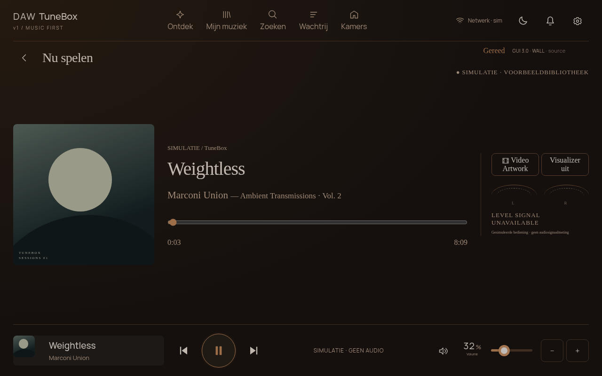

# GUI3.0 wall-panel release and hardware test

Release: `2026.11.07-wall.1` / **GUI3.0 · WALL**. New panel geometry is **provisional1280×800 (16:10)**, from the owner's new screen drawing. Do not reuse the old400×1280 kernel overlay on a different screen merely because this GUI fits. Confirm the screen SKU and manufacturer-required overlay first. No installer here changes boot files, physical timings or amplifier verification.

## Start and identify the build

```sh
npm ci
npm run dev
```

- Product: http://localhost:5173/?gui=2&screen=1&display=hdmi-development&panel=wall-16-10
- Shared hardware simulator: http://localhost:5173/?gui=2&lab=1&panel=wall-16-10
- Existing ultrawide screen: http://localhost:5173/?gui=2&screen=1&display=hdmi-development&panel=legacy-wide



The new panel is1280×800 logical pixels, centred and letterboxed on HDMI, scaled down for smaller browser windows. DSI production uses1:1 geometry; verify rotation and native mode separately. Same backend, Music Assistant, theme engine, safety runtime and settings; no second demo. Six skins inherit the same tokens. No physical volume knob is required.

Check the on-screen Softwareversie badge or `/api/health`: **GUI3.0 · WALL**. Refresh after restarting the backend. A commit alone does not update an already installed Pi or guarantee a signed OTA build exists.

## Raspberry Pi install / profile selection

Use the existing [Pi guide](raspberry-pi.md) and [first-run checklist](pi-first-run.md). With a checked-out updated source tree and supported ARM64 Node runtime:

```sh
npm ci
npm run package:pi
# The package command runs tests/build and generates tunebox-release.tar.gz.
# Extract that archive into a fresh directory on the Pi, then inside it:
sudo bash deploy/install.sh --target auto --prebuilt --music-assistant skip
cd /opt/daw-one
npm run doctor
sudo bash /opt/daw-one/deploy/set-panel-profile.sh wall-16-10
sudo /opt/daw-one/set-display-mode.sh hdmi-development
sudo systemctl restart daw-one-kiosk.service
```

For Pi3 use the detected experimental profile and static visuals; performance on hardware is not certified. Switch to `dsi-production` only after the OS independently displays a test pattern on the new verified screen. To revert GUI geometry, choose `legacy-wide` with the same script. Profile selection changes browser geometry only. The profile file is preserved by OTA. Existing devices migrating from an older launcher should use the installer once; then subsequent profile changes need only a kiosk restart. Music Assistant secrets remain on the Pi; never put them in GitHub or a bundle.

## Screen rest and notification flows

Settings → page16 **Schermrust** selects clock/date, sensor widgets, calculated sunset, static glow, Now Playing or black. Set latitude/longitude locally for sunset; no permission request or location service is used. No coordinates means an explicit unavailable message. Sunset is approximate and uses the browser's calendar date and timezone; set the Pi timezone correctly.

Moon button enters screen rest via the existing `display-timeout` API. Music continues. The existing runtime sleeps after30seconds without user activity; ongoing trusted interaction refreshes this timer. First touch/key wakes only the display and is swallowed, so it cannot accidentally play/seek/change volume. Standby-mode display wake leaves the device in standby and cannot enable the amplifier. Faults retain the safety gates. A critical runtime fault remains visible even over black rest mode. The black mode draws black pixels: **actual backlight/DPMS power control is not implemented or claimed**. Reduced motion and Pi3 avoid animated transitions; glow is static, not an endless animation.

Bell → six paged categories: system report/status, updates, hardware alert, newsletter, What's new, tutorial. Escape closes and returns focus; native modal dialog confines keyboard focus. Update opens existing update settings, never auto-installs. PD checks are sourced from the existing boot report: unknown real negotiation is never presented as measured100W. Simulation is labelled. Newsletter is a local information placeholder; there is no subscription, external feed or outbound message. Tutorial and release notes work offline.

Wi-Fi strength is read through the existing optional device manager using NetworkManager's cached AP list (`--rescan no`); no network scan is triggered. Backend coalesces/cache reads for30s; hidden browser tabs stop polling. Missing manager, missing signal, Ethernet-only and backend offline show unavailable rather than invented bars. No SSID or password is returned by `/api/network`. The displayed percentage is NetworkManager signal quality, not measured throughput.

## Hardware acceptance — leave unchecked until tested

- [ ] Manufacturer model, resolution, aperture and rotation confirmed; desktop/test pattern visible before kiosk.
- [ ] Pi4 keyboard, pointer and touch align across every corner, including wake.
- [ ] All six skins and all top navigation pages fit native screen; no document scrolling.
- [ ] Settings page swipe and next/previous work; volume/play controls are usable with a finger.
- [ ] Play/seek/queue from Music Assistant reflect the chosen player; audio survives screen rest and reconnect.
- [ ] All6rest views, timeout during playback, continuous interaction and fault during sleep tested.
- [ ] PCT2075 reads1decimal and TSL2591whole lux in widgets; stale/error/offline is unavailable.
- [ ] Wi-Fi signal updates on the Pi, Ethernet does not masquerade as Wi-Fi, and network loss clears the display.
- [ ] PD below100W/unknown and thermal/controller faults produce clear alerts without actuator enable.
- [ ] Actual DSI backlight control separately designed and verified; black pixels alone are not power-off.
- [ ] CPU/RAM, temperatures, touch latency and animations measured during sustained playback on actual Pi.
- [ ] Top physical button/LED driver, amplifier mute/shutdown, PD protection and wiring verified independently.

## iPhone / iPad

Run `npm run dev` on the Mac, use Vite's displayed Network URL with the new product query above, and open it in Safari on the same LAN. Allow the Mac firewall prompt if needed. This does not use Codespaces. HTTP previews can test controls, settings, themes, rest views and notifications; offline service-worker testing needs HTTPS or localhost. Screen-size scaling shrinks physical touch targets on small phones; use landscape/full-screen iPad for a realistic demonstration.

## Remaining blockers

No actual new screen test, CAD fit, Sonocotta HAT electrical/thermal validation, real PD negotiation, fan control, GPIO button/LED driver, measured RF strength on owner's device, hardware backlight control or signed OTA availability has been certified by this change. Existing black-screen diagnosis is unresolved; working touch and Pi page flips never prove panel reception.
